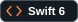
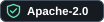

<h1 align="center">Agent HUD Open — board only</h1>

  Quota windows, API balances, the last 24 hours of tokens and the recent sessions of Claude Code, Codex and 15 more agents, in a panel that opens from your Mac's notch or from a row of agent logos on any screen edge.

  
  
  

  <strong>English</strong> · <a href="README.zh-CN.md">简体中文</a> · <a href="#supported-agents">Supported agents</a> · <a href="#documentation">Documentation</a>

This is a board-only build of [Agent HUD Open](https://github.com/jazzenchen/agent-hud-open), the Swift macOS app, forked from upstream v0.5.3. Upstream has since moved to a separate Rust/Tauri rewrite. This branch keeps the Swift code and only its core, the board; everything else was removed. The app is still called Agent HUD Open, and its bundle still says 0.5.3.

## The board

Hover the notch or the logos and the panel opens. From the top:

- **Refresh error**: what went wrong, when the last refresh failed.
- **Quotas**: each vendor's windows, grouped by account, with what is left of each and when it resets. A row is green under 70% used, yellow from 70% and red from 90%. A picker switches a vendor's block between the share left (%), the burn rate and tokens per hour (#); hovering a row shows its outlook, such as when it runs out at its pace. Codex accounts list their available usage resets, and Grok its prepaid and on-demand amounts.
- **Balances**: for an API billed by use, such as DeepSeek's, the account balance and the estimated cost of the last 24 hours.
- **Tokens**: the last 24 hours in 96 quarter-hour bars, every model stacked in its own colour and every token kind counted. Hovering a bar shows its period and each model's tokens.
- **Sessions**: up to five, those with work in flight first, sessions waiting for you ahead of those still running, then those active in the last day; "+N more" counts the rest. A row shows the agent's logo with the session's state on its corner, its title and its tokens. Rows are not clickable.

The footer has Settings (gear) on the left and Quit (power) on the right. Opening the panel reads every account's quota again, at most once a minute per agent. Settings → Display → Expanded panel switches the quotas and balances, the reset countdowns, the token chart and the session list.

## Modes and settings

Each display runs one of three modes, chosen in Settings → Display → Screens:

| Mode | On screen |
| --- | --- |
| **Notch** | The default on a display with a notch: the HUD sits at the notch. On a display without one, a black bar stands in for it at the top centre. |
| **Dynamic** | The default elsewhere: the agents' logos in a row on any screen edge, bare, with no backdrop. Drag the row to another edge or position; dragging the notch switches it to Dynamic. |
| **Off** | No HUD on that display. With every display off, the main display keeps its HUD, since its panel is the way into Settings. |

The row shows the agents you watch, then any other agent run in the last day; agents that share artwork share a logo. The open panel and the notch cast a soft shadow; a collapsed row of logos casts none.

Settings, from the gear in the panel's footer:

- **General**: appearance, language (English or Simplified Chinese), launch at login, and client hooks.
- **Agents**: for each agent, the accounts and windows to show and their order, Live status, and for GitHub Copilot the consent to read its quota; Pi and OpenCode say whether their observer is in place.
- **Display**: for each display, the mode, Reset Position, logo size, distance from the edge, spacing and Show logos (off, the row keeps its place and hovering there still opens the panel); what the panel shows; and hover behavior: Press Option to open, Open immediately at the top edge, and the hover and collapse delays.

## What was removed

Compared with upstream v0.5.3, code and interface alike:

- The glow, with every style and effect, its settings and ⌘⌥H; the bots.
- Simple mode, and Separate agents with its per-agent cards.
- Island alerts and reminders: quota warnings, added usage resets, New reply.
- Answering permission requests and questions on the HUD, for every client, Codex Desktop, Antigravity and DeepSeek Harness.
- Returning to a session from the HUD.
- The statistics window, the menu bar item and its menu, the onboarding window.
- Demo mode, demo scripts, `--snapshot` and `--record`.
- The host extension points: extra settings pages, menu items, HUD controls and the island-event relay.
- The beta update feed.

## Client hooks

With **Client hooks** on in Settings → General, the default, every start points these handlers at the running copy and adds those missing for the agents installed:

- **Claude Code's notification hook**: a Claude Code session shows as waiting for approval while Claude Code asks for permission or for input.
- **GitHub Copilot CLI's stop hook**: a Copilot turn still running ends at once.
- **Pi's extension and OpenCode's plugin**: Pi's running and finished turns, without which Pi sessions never show as running, and OpenCode's finished turns.

The stop hooks fuller builds added to Antigravity, Cursor, CodeBuddy and Qwen Code only fed turn reminders, since those clients' sessions never show as running; every start takes them out. Switching Client hooks off removes every Agent HUD handler, whichever copy added it, and adds none back; usage, quota and sessions are unaffected.

**Retired handlers.** Fuller builds also installed `--permission-hook <client>`, to answer permission requests on the HUD, and `--session-origin-hook <claude|codex>`, to find a session's terminal. A client that still calls one gets an answer at once, and the app does not start: nothing for a permission request, so the client shows its own prompt, and `{}` for a session-origin hook. Every start, and every switch of Client hooks, takes those handlers out of Claude Code's `settings.json`, Codex's `hooks.json` and the settings of Qoder, Qoder CN, QoderWork, CodeBuddy, WorkBuddy, ZCode and Qwen Code, when they run this copy's own executable. Handlers of other programs are left alone. Details: [retired handlers](docs/session-lifecycle.md#retired-handlers).

## Supported agents

Install and sign in to the agents you want to monitor; the app finds them by itself. All 17 report tokens and sessions.

| Agent | Quota | Live status | Client hook |
| --- | :---: | :---: | --- |
| **Claude&nbsp;Code** | ✓ | ✓ | Notification hook |
| **Codex** | ✓ | ✓ | |
| **DeepSeek&nbsp;Harness** | Balance | ✓ | |
| **Antigravity** | ✓ | | |
| **Cursor** | ✓ | | |
| **Grok&nbsp;CLI** | ✓ | ✓ | |
| **Grok&nbsp;Bot** | ✓ | | |
| **GitHub&nbsp;Copilot&nbsp;CLI** | ✓ | ✓ | Stop hook |
| **OpenCode** | ✓ | | Plugin |
| **Kimi** | ✓ | ✓ | |
| **Pi** | ✓ | ✓ | Extension |
| **OpenClaw** | | ✓ | |
| **Hermes&nbsp;Agent** | | | |
| **ZCode** | | | |
| **CodeBuddy** | | | |
| **WorkBuddy** | | | |
| **Qwen&nbsp;Code** | | | |

Live status means the panel shows which sessions are running; only Claude Code's also show waiting for approval, and Pi's need its extension. Also read: the **GLM Coding Plan** quota. Copilot's quota needs your consent in Settings → Agents. The rest is in [each agent's details](docs/providers.md).

## Your data

- **Read on your Mac**: the records your agents already keep. Usage history stays in a local database.
- **Read from each vendor**: quotas, balances and account usage, with the agent's existing sign-in or configured key. No read sends a message to a model, and credentials are never stored.
- **Written on your Mac**: the client hooks above, in your agents' own settings and directories, and the records they leave for the app; at every start, this copy's retired handlers are taken out of those settings. **Client hooks** in Settings → General removes the hooks.
- **Uploaded**: nothing.

The app keeps its data in `~/Library/Application Support/Agent HUD Open Desktop` when built with `make build`, whose `Info.plist` names that directory, and in `Agent HUD Open` where none is named. See also [data access](docs/data-access.md).

## Build from source

**Requirements:** macOS 14+ and Xcode or the Xcode Command Line Tools with a Swift 6 toolchain. No developer account, signing identity or provisioning profile is required.

| Command | Purpose |
| --- | --- |
| `make build` | Build `build/Agent HUD Open.app`, signed ad-hoc for local use |
| `make run` | Build the app and open it |
| `make test` | Run the unit tests (`swift test`) |
| `make check` | Check source boundaries |
| `make clean` | Remove `.build` and `build` |

`swift test` runs the tests without `make`. Launch switches such as `--open-panel`, `--show-settings` and `--probe` are listed under [command line](docs/command-line.md).

The Swift package exposes `AgentHUDSupport` (records and identities), `AgentHUDCore` (providers, models, storage and client hooks) and `AgentHUDDesktop` (the HUD and the Settings window); `AgentHUDOpen` is the standalone executable. A host can embed the libraries with a provider of its own; see [host integration](docs/architecture.md#host-integration). CI checks source boundaries, runs the unit tests, builds the app and verifies its signature and resources.

## Documentation

[The HUD](docs/hud.md) · [Providers](docs/providers.md) · [Usage semantics](docs/usage-semantics.md) · [Session lifecycle](docs/session-lifecycle.md) · [Data access](docs/data-access.md) · [Architecture](docs/architecture.md) · [Performance](docs/performance.md) · [Command line](docs/command-line.md) · [Brand assets](docs/brand-assets.md) · [Changelog](CHANGELOG.md)

## License

[Apache-2.0](LICENSE). Provider references and icon assets retain their [third-party notices](THIRD_PARTY_NOTICES.txt) and [icon license](Sources/AgentHUDDesktop/Resources/LobeIcons-LICENSE.txt).
